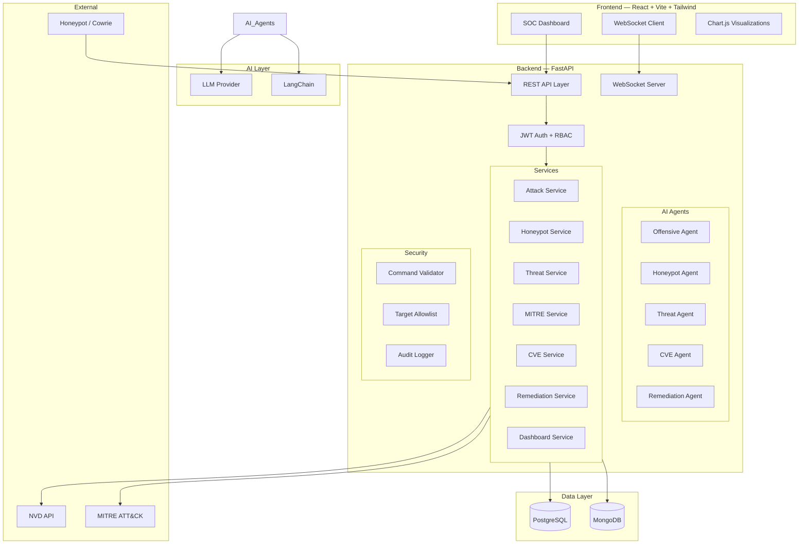

# Cyberary-AI Architecture

## System Overview

Cyberary-AI is an autonomous offensive & defensive cyber defense platform that connects:

- **Ethical Attack Simulation** — AI-driven vulnerability assessment against authorized lab targets
- **Dynamic AI Honeypot** — LLM-powered honeypot maintaining session context
- **Threat Intelligence Engine** — Converts attack logs into actionable intelligence
- **MITRE ATT&CK Mapping** — Automated technique identification and tactic correlation
- **CVE Assessment** — NVD-powered vulnerability lookup with CVSS scoring
- **Contextual Risk Engine** — Multi-factor risk calculation beyond raw CVSS
- **Remediation Engine** — AI-generated fixes with human approval workflow
- **SOC Dashboard** — Unified real-time security operations interface

## Architecture Diagram

## Component Details

### Frontend
- **React 18** with React Router v6 for SPA navigation
- **Tailwind CSS v3** with custom dark cybersecurity theme
- **Chart.js** for security metric visualizations
- **Axios** with JWT interceptors for API communication
- **WebSocket** for real-time event streaming

### Backend
- **FastAPI** async framework with auto-generated OpenAPI docs
- **SQLAlchemy** async ORM for PostgreSQL operations
- **Motor** async driver for MongoDB operations
- **Pydantic** for request/response validation
- **SlowAPI** for rate limiting

### Security Model
- JWT authentication with bcrypt password hashing
- Role-based access control (ADMIN, SOC_ANALYST, SECURITY_ENGINEER, VIEWER)
- Target allowlist restricting offensive operations to lab assets
- Command validator blocking dangerous AI-generated commands
- Immutable audit logging for all sensitive actions
- LAB_MODE enforcement for all offensive operations

### Data Model
- **PostgreSQL**: Structured data (users, roles, assets, vulnerabilities, remediations)
- **MongoDB**: Flexible logs (honeypot sessions, terminal events, threat events, LLM analysis)

### AI Integration
- Abstraction layer supporting Ollama (local) and OpenAI-compatible providers
- LangChain for agent orchestration
- Structured JSON output with Pydantic validation
- Safe retry mechanism for malformed LLM responses
